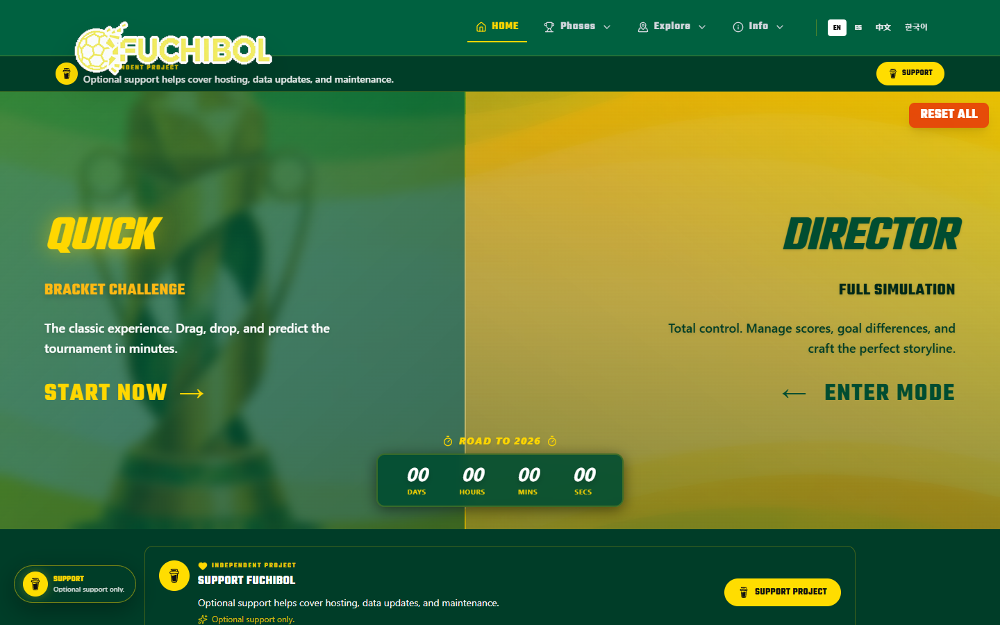
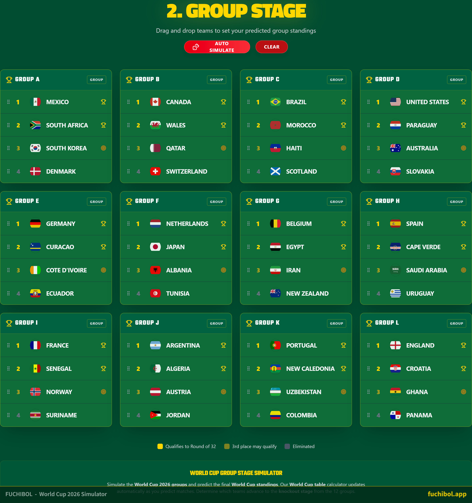
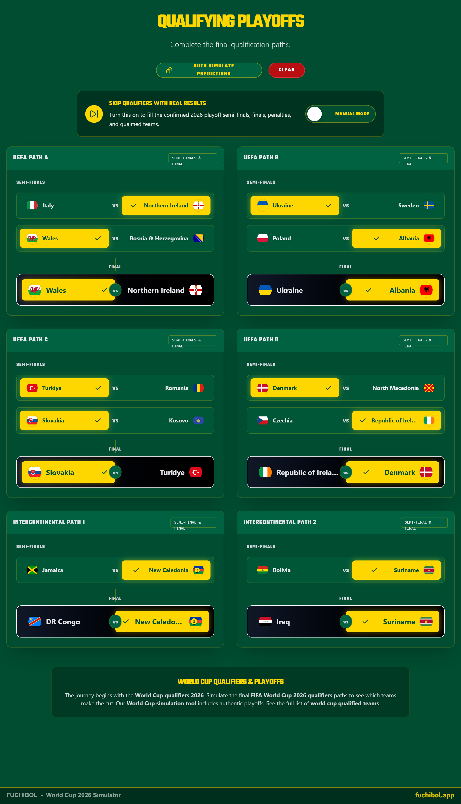

# FUCHIBOL

### Tu Mundial, tus decisiones

Simulador interactivo del Mundial 2026 para explorar grupos, cuadros y escenarios posibles de cada selección.

**Periodo documentado:** 2025–2026  
**Estado:** Producto web público en fuchibol.app; código de desarrollo privado  
**Tecnologías:** React · TypeScript · Vite

## Qué hace

- Simulación de grupos y fases eliminatorias.
- Herramientas para imaginar rutas de los equipos y compartir predicciones.
- Contenido de consulta sobre sedes, calendario y formato del torneo.

## Vista del proyecto

Portada capturada del sitio público en octubre de 2026. Las vistas de grupos y eliminatorias corresponden a una demostración de junio de 2026.

### Portada actual de FUCHIBOL

### Simulación de fase de grupos

### Simulación de eliminatorias

## Contexto

Proyecto digital personal.

Esta vitrina contiene únicamente texto e imágenes seleccionadas para presentación. El código fuente, los datos y el historial del proyecto no se publican aquí.

[Ver la ficha visual de FUCHIBOL](https://alfredoae2578.github.io/projects/fuchibol-presentacion.html)

[Ver todos los proyectos](https://alfredoae2578.github.io/)
